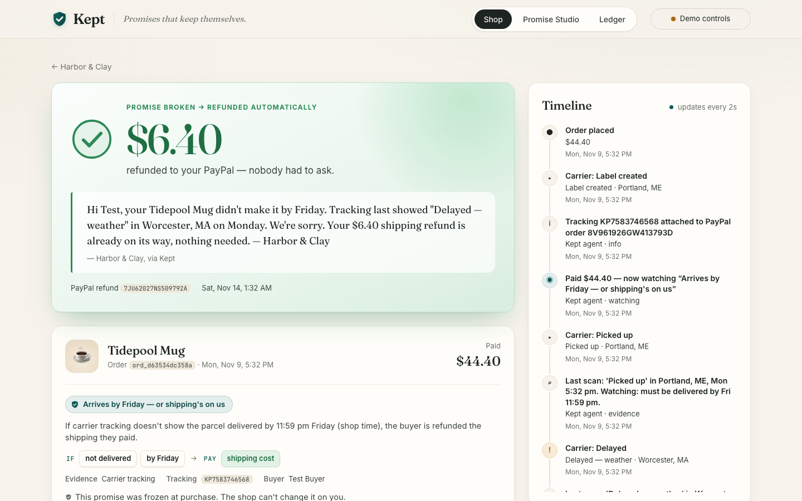
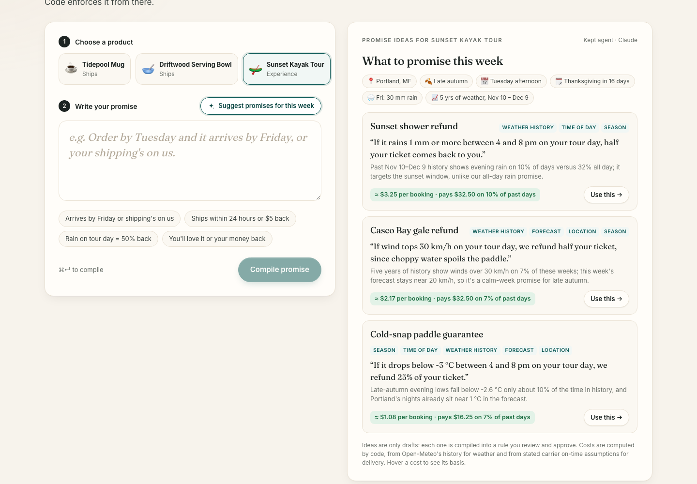
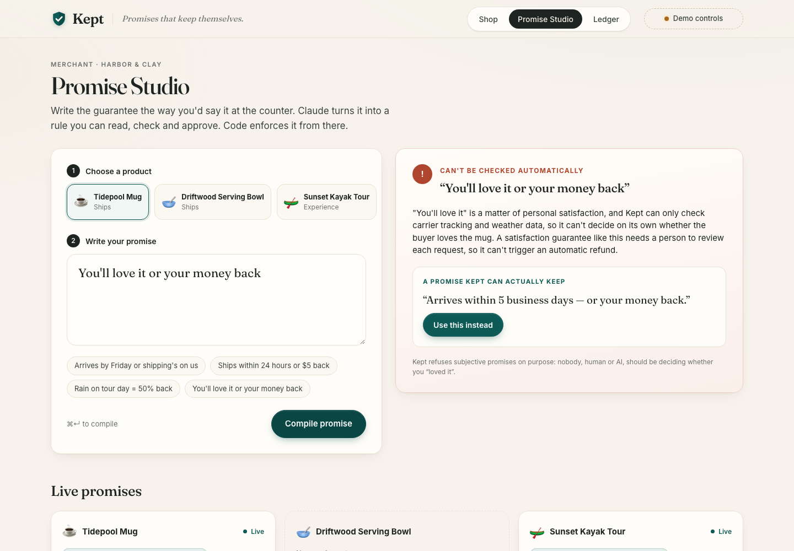
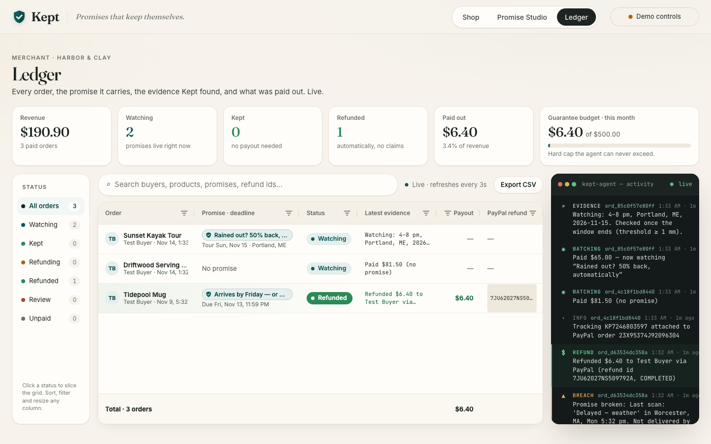

# Kept: promises that keep themselves

A merchant writes a guarantee in plain English, like *"Arrives by Friday or shipping's on us"* or *"Rain on tour day = 50% back."*
The **Kept agent**, an LLM agent powered by Claude, turns it into a rule that can be checked. An autonomous **watcher** checks real-world evidence (carrier tracking, live Open-Meteo weather) against that rule, and the **Kept agent reviews messy carrier evidence**: it can pause a payout for the merchant, but never create one. When a promise breaks, **PayPal refunds the buyer automatically**, before they ask, with a note explaining why.

Built for the [PayPal AI Hackathon](https://paypalaihackathon.devpost.com/), 2026.



## The problem
Guarantees are the cheapest trust signal a small shop has, and the hardest to keep. A two-person studio can write "arrives by Friday or shipping's on us", but then someone has to check every parcel, notice every miss, and process every refund. In practice the buyer has to notice, complain and argue. Most never do, so the promise quietly turns into marketing.


## How Kept differs from what exists
Pieces of this already exist. Weather guarantees that pay out automatically ([Sensible Weather](https://www.sensibleweather.com/), [WeatherPromise](https://purchase.weatherpromise.com/us/en/)) are fixed products sold by an insurer. Merchant-run shipping guarantees ([ShipAid](https://www.shipaid.com/)) still rely on the buyer filing a claim. AI support agents (for example [Yuma](https://yuma.ai/ai-support-agent)) can resolve late orders proactively, but a model decides each case. LLM "intelligent contracts" ([GenLayer](https://docs.genlayer.com/understand-genlayer-protocol/typical-use-cases)) also have a model judge each claim. Delivery-date tools ([Narvar Promise](https://corp.narvar.com/promise), [LateShipment Promise](https://apps.shopify.com/estimated-delivery-date-1), [Shopify Shop Promise](https://www.shopify.com/shop-promise)) already factor in holidays and weather, but to *estimate* a date, not to back it with a payout.

Kept makes a different split:
- **The AI compiles the promise; code keeps it.** The Kept agent turns the merchant's words into a typed rule *once*. The merchant reviews and approves it, and from then on no model decides money. The outcome is deterministic, auditable, capped and testable.
- **The promise is a contract the buyer can see.** The exact rule is shown at checkout and frozen into the order. It isn't an internal policy hidden behind a support bot.
- **Promises that can't be checked are refused.** "You'll love it or your money back" gets a rewrite that can be checked, not a fake guarantee.
- **Promises designed for the moment, priced before they go live.** The Kept agent suggests promises from the intersection of the product, the season, upcoming holidays, the day, this week's forecast and years of local weather history. Code prices each one, so the merchant sees what it will likely cost per order before approving it.
- **One engine for any promise, in the merchant's own words.** Delivery and weather today, on the same rule language, with no fixed product catalog.
- **Native to the payment.** Refunds go against the PayPal capture, tracking is attached to the same capture, and a monthly budget caps total exposure.

## How it works

| | |
|---|---|
| **0. Suggest** | Not sure what to promise? Click **Suggest promises for this week**. The Kept agent (Claude) reads the product and the moment: season, upcoming US holidays, day and time, the live 7-day Open-Meteo forecast at the shop and five years of weather for the same weeks. It drafts five promises; code compiles and prices each and shows the best three, for example *"Order by Nov 20 and it's here before Thanksgiving, or 20% back"* or *"Rain between 4 and 8 pm on your sunset tour? Half your ticket back."* Each idea is compiled like a typed promise and **priced by code**: weather promises from history ("would have paid out on 15 of 150 days"), delivery promises from stated carrier on-time assumptions. The agent only drafts; the merchant still approves, and the same caps apply. |
| **1. Write** | In the **Promise Studio**, the merchant types a promise. The Kept agent (Claude Haiku 4.5, structured output validated by Zod) compiles it into a small typed rule language: condition, deadline or weather threshold, and payout. It lists every assumption it made and every question the merchant should settle. Subjective promises ("you'll love it") are refused, and Claude suggests a checkable rewrite. |
| **2. Approve** | The merchant approves the rule. It goes live as a badge on the product. |
| **3. Buy** | The buyer pays with **PayPal Checkout** (Orders v2). The promise is frozen into the order, and the shipment's tracking number is attached to the PayPal capture (Orders v2 tracking). |
| **4. Watch** | A deterministic watcher loop checks the evidence: carrier scans, or real hourly weather from Open-Meteo for the tour window. Every observation is written to an audit trail. |
| **4½. Review** | When a delivery promise breaks, the Kept agent (Claude) reads the carrier scans and decides *whose fault* the miss looks like. Ordinary delays, weather and lost parcels are the shop's risk, so the payout goes ahead. If the evidence points at the buyer ("Delivery attempted — no one available to sign", "address incomplete"), the Kept agent **pauses** the payout and the merchant decides. The agent can hold a payout. It can never create one, approve one or change the amount. If the model is unavailable, the default is to pay. |
| **5. Keep** | When a promise breaks, code computes the payout and **PayPal Payments v2** issues a partial refund (idempotent, with `note_to_payer`). The Kept agent (Claude) writes the buyer a short note citing the evidence. |
| **6. Account** | The merchant's **AG Grid ledger** shows every order, its latest evidence, the decision, the payout and the PayPal refund id, with live updates and a budget meter. |



| Promise Studio | Ledger (AG Grid) |
|---|---|
|  |  |

## Why it matters for PayPal
Kept is built on PayPal from end to end: the purchase, the shipment and the payout all run against the same PayPal capture. That gives PayPal and its merchants five things.

- **Disputes settled before they're opened.** A late parcel is exactly what turns into an *Item Not Received* dispute. Kept refunds the agreed amount, with a note citing the scan, before the buyer would think to complain. A buyer who already has their money and an explanation has little reason to open a dispute. That saves the merchant a fight, the buyer a wait, and PayPal a case to review.
- **Tracking on every order, automatically.** Kept attaches the tracking number to the capture through the Orders v2 tracking API on every shipped order. PayPal uses that tracking for [Seller Protection eligibility and earlier release of payment holds](https://developer.paypal.com/docs/tracking/tracking-api). Small merchants, who are the most likely to skip this step, get it without thinking about it.
- **A reason to choose PayPal at checkout.** The guarantee is shown at checkout, frozen into the order, and paid back to the buyer's PayPal account with PayPal's own `note_to_payer`. The buyer sees PayPal keep the shop's promise.
- **A merchant feature PayPal could offer natively.** Amazon-grade delivery promises usually need an ops team. Kept gives them to small shops, PayPal's core merchants, as a few sentences of plain English, with a monthly budget so exposure is always capped. It could ship as a "Promises" option on any PayPal checkout.
- **Promises an AI shopping agent can read.** Each promise is a typed, machine-checkable rule, not marketing copy. In agentic commerce a buying agent can compare guarantees across shops and trust that PayPal will enforce them, which makes PayPal the settlement layer for agent-made promises.

**PayPal APIs used:** Orders v2 (create and capture, with item and shipping breakdown), Orders v2 tracking (shipment attached to the capture), Payments v2 refunds (partial, idempotent `PayPal-Request-Id`, `note_to_payer`), and the JavaScript SDK Buttons for checkout.

## Trust by design
- **The AI writes the rule; code enforces it.** The Kept agent never decides an amount.
- **The AI's power over money is one-way.** The Kept agent can pause a payout for human review. It can never trigger, approve or enlarge one. `server/watcher.ts` evaluates the rule and computes the payout.
- **Payouts are capped** at the captured amount and at the merchant's monthly guarantee budget. Over budget, the watcher stops and asks a human.
- **A human approves every rule** before it goes live.
- **The buyer gets the promise they saw.** It's frozen at purchase.
- **Refunds are idempotent**, keyed on the order id, so a retry can never pay twice.
- **The model is never on the critical path for money.** If the model is unavailable, the refund still goes out with a template note.

## Try it (judges)

**Hosted demo:** https://kept-jhjl.onrender.com (free tier: the first load after a quiet spell can take ~1 minute while it wakes up)

_Harbor & Clay, the shop in the demo, is fictional. Its Portland, Maine location is real only so the weather promise can use real Open-Meteo data. All payments are PayPal sandbox; no real money moves._

1. **Shop:** buy the *Tidepool Mug*. Either:
   - Click **"Judges: skip login — pay with PayPal sandbox test card"** (no account needed), or
   - Click the PayPal button and log in with the sandbox buyer below.
2. You land on the order page: *"Watching your promise."*
3. Open **Demo controls** (top right):
   - Under the order, click **Delayed (weather)**.
   - Then click **Jump to Saturday 00:01**.
4. Within seconds the order page flips to **"$6.40 refunded to your PayPal"**, with the Kept agent's Claude-written note and the real PayPal sandbox refund id.
5. Open **Ledger** to see it in AG Grid, plus the activity log (every observation, agent review and payout).
6. Open **Promise Studio**, pick a product and click **Suggest promises for this week** (about 15 seconds): three promises fitted to this week, each with its expected cost. Click **Use this** to see the compiled contract. Or write your own: try *"You'll love it or your money back"* to see a rejection.

The kayak tour checks **real weather** for the date and city you pick. Demo controls can also simulate rain; simulated evidence is clearly labelled as such.

**PayPal sandbox buyer** (sandbox only, no real money):
- Email: `sb-dt47k053823678@personal.example.com`
- Password: `mZF6&A9M`

## Run locally
Requirements: Node 22.13+ (uses the built-in `node:sqlite`), a PayPal sandbox app, and an Anthropic API key.

```bash
git clone https://github.com/igorbnd/kept && cd kept
npm install
cp .env.example .env     # fill in PAYPAL_CLIENT_ID, PAYPAL_CLIENT_SECRET, ANTHROPIC_API_KEY
npm run dev              # API on :8787, web on http://localhost:5173
```
Production: `npm run build && npm start` serves everything on `:8787`. To deploy on Render, use the included `render.yaml` blueprint.

End-to-end check against the real sandbox, with the API running:
```bash
./scripts/e2e.sh           # buy → parcel delayed → Friday passes → PayPal refund → agent note
./scripts/e2e-weather.sh   # kayak tour: 4 mm rain → 50% PayPal refund; 0 mm → promise kept
```
(Both reset the demo data. Point them elsewhere with `API=http://localhost:PORT`.)

Public deploys are rate-limited per IP (e.g. 10 promise compiles, 30 orders, 3 demo resets per 10 minutes) and keep only the newest 200 orders and 1,000 agent events. Requests from localhost with no proxy headers are exempt; set `RATE_LIMIT=off` to disable entirely. On an empty ledger, **Demo controls → Load sample history** buys 4 real sandbox orders with the test card (their carrier scans and one rainy day are simulated, and labelled as such).

## Architecture
```
web/ (React + Vite + AG Grid)  ──►  server/index.ts (Hono)
                                        ├─ ai/compiler.ts   Claude: promise → typed rule (structured output)
                                        ├─ ai/suggester.ts  Claude: promise ideas from product × season × holidays × forecast × history
                                        ├─ pricing.ts       expected cost per order (Open-Meteo history / carrier assumptions)
                                        ├─ ai/narrator.ts   Claude: buyer refund note (≤255 chars, with fallback)
                                        ├─ paypal.ts        Orders v2 create/capture/track · Payments v2 refund
                                        ├─ watcher.ts       autonomous loop: evidence → verdict → (Claude review) → capped payout
                                        ├─ sources/         Open-Meteo weather, forecast and history (real) · holidays · KeptPost carrier (simulated)
                                        └─ db.ts            Node built-in SQLite + simulated clock for demos
```

## AI tools used
- **Claude Haiku 4.5** (`claude-haiku-4-5-20251001`, Anthropic API) is the model behind the Kept agent at runtime, chosen to keep a public demo cheap; set `KEPT_MODEL` to run a larger Claude model instead. It suggests promises for the moment, compiles promises into rules, reviews breached delivery evidence (it can only pause a payout), and writes buyer refund notes. All model calls live in `server/ai/`, so another LLM could be used by reimplementing those four functions.
- **Claude Code** helped build this project.

## Built during the submission period
Everything in this repo was written from scratch between Nov 9 and Nov 12, 2026.

## License
[MIT](LICENSE)
